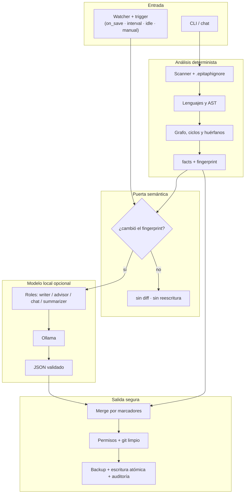

# EPITAPH — Documentación viva, local y no destructiva

[](https://python.org)
[](tests/)
[](https://ollama.com)
[](LICENSE)

> **EPITAPH** mantiene el `README.md` de tu proyecto sincronizado con el código. Analiza la
> arquitectura de forma determinista (árbol, dependencias, ciclos, código muerto, puntos de
> entrada y secretos), redacta únicamente la prosa que no se puede derivar y fusiona el
> resultado por secciones delimitadas, sin tocar el texto escrito por humanos.
>
> Funciona con modelos locales (Ollama / llama.cpp): sin claves de API, sin telemetría y sin
> enviar tu código a terceros. Si nada cambió, no produce ningún diff.
>
> **Estado:** alpha (`0.1.0`).
>
> - Especificación técnica: [EPITAPH_DOCUMENTO_TECNICO.md](documentation/EPITAPH_DOCUMENTO_TECNICO.md)
> - Decisiones de arquitectura: [documentation/adr/](documentation/adr/)
> - Guía de contribución: [CONTRIBUTING.md](CONTRIBUTING.md)

---

## Inicio rápido

### 1. Instalación

Requisitos: Python 3.12+, Git y [`uv`](https://docs.astral.sh/uv/).

```bash
uv venv
source .venv/bin/activate
uv pip install -e ".[dev]"
```

### 2. Configuración inicial

El wizard elige funciones, cadencia, modelo y permisos:

```bash
epitaph init
```

Genera `.epitaph/config.toml` y `.epitaph/state.json`.

### 3. Primera actualización

```bash
epitaph update --dry    # propuesta de README, sin escribir nada
epitaph update --yes    # aplica los cambios
```

El README resultante contiene bloques gestionados por EPITAPH y conserva intacto el texto
humano. Una segunda ejecución sin cambios responde `sin cambios`: cero diff.

Si el repositorio tiene cambios sin confirmar, el guard de git bloqueará la escritura: haz
commit/stash o usa `--force`.

### 4. Chat interactivo

```bash
epitaph
```

Dentro del chat puedes actualizar, revisar el diff, cambiar la cadencia o expresar
preferencias en lenguaje natural:

```text
/update --dry
/models
/every 10m
> prefiero el árbol al final y sin badges
```

### 5. Sin modelo local

El análisis y la generación determinista funcionan sin Ollama:

```bash
epitaph update --no-llm
```

Para añadir prosa generada, instala Ollama y un modelo de código:

```bash
ollama pull qwen2.5-coder:3b
epitaph doctor
```

---

## Características principales

### 1. Análisis determinista y multi-lenguaje

- **Scanner con `.epitaphignore`**: respeta exclusiones, ignora artefactos generados y limita
  el análisis para no bloquear el terminal.
- **13 lenguajes de código**: Python, JavaScript, TypeScript, Go, Rust, Java, Kotlin, Ruby,
  PHP, C, C++, C# y shell.
- **AST nativo en Python** y extracción de imports para JS/TS, Go, Java/Kotlin, Rust y PHP.
- **Grafo de dependencias**: ciclos, módulos huérfanos, puntos de entrada y dependencias
  externas reales (stdlib e imports internos quedan fuera).
- **Métricas**: LOC/SLOC, funciones, clases, complejidad ciclomática, Halstead e índice de
  mantenibilidad.
- **Secretos**: detección y enmascarado antes de cualquier inferencia.

### 2. README no destructivo por marcadores

- Cada sección gestionada vive entre `<!-- epitaph:begin id=… -->` y `<!-- epitaph:end -->`.
- El merge es **idempotente**: usa el fingerprint de la sección para no reescribir lo que no
  cambió.
- El texto fuera de los marcadores **nunca se toca**.
- Si los marcadores están rotos, no se escribe el README: se genera `README.suggested.md`.
- Estructura configurable por presets, orden explícito o lenguaje natural.

### 3. Escritura segura y auditable

- **Permisos por acción**: `write:readme`, `write:requirements`, `write:suggestions`,
  `write:code` y `network`.
- **Guard de git limpio** (configurable): ignora los artefactos propios para que `init` no
  bloquee el primer `update`.
- **Backups con retención** y comando `epitaph undo`.
- **Escritura atómica** (`.tmp` + rename) y auditoría append-only en `.epitaph/audit.log`.
- **`--dry`** para ver la propuesta sin tocar el disco.

### 4. Modelo local por roles y hardware-agnóstico

- Roles separados: `writer`, `advisor`, `chat` y `summarizer`.
- Selección de modelo por rol con `epitaph models role` o desde el chat.
- Detección de hardware (hilos, RAM, GPU) y estimación de viabilidad del modelo.
- Registro local de ejecuciones y métricas de tokens en `.epitaph/cache.db`.
- El modelo **nunca escribe archivos ni ejecuta comandos**: devuelve JSON validado.

| Rol | Modelo por defecto | Uso |
|---|---|---|
| `summarizer` | `qwen2.5-coder:1.5b` | Resúmenes y contexto ligero |
| `writer` | `qwen2.5-coder:3b` | Prosa del README |
| `advisor` | `qwen2.5-coder:3b` | Análisis y recomendaciones |
| `chat` | `qwen2.5-coder:3b` | Conversación interactiva |

### 5. Preferencias en lenguaje natural

- Frases como *«pon instalación antes de arquitectura»* se convierten en una propuesta.
- La propuesta se valida, se confirma y se persiste en `.epitaph/preferences.toml`.
- Ámbitos cerrados: estructura, estilo, idioma, modularización, filtros, nombres y directivas.
- Una preferencia **no puede ampliar permisos** ni silenciar avisos de seguridad.
- Cada preferencia añadida queda auditada y se revierte con `epitaph prefs rm`.

### 6. Dependencias y sugerencias accionables

- Cruza los imports reales con `requirements.txt` y detecta dependencias que faltan o sobran.
- Escribe `requirements.suggested.txt`; **nunca modifica** el archivo original.
- Genera `suggestions.md` con hallazgos priorizados: seguridad, arquitectura, dependencias,
  modularidad, código muerto, tooling y documentación.
- Las preferencias del usuario filtran y ordenan el informe sin ocultar categorías críticas.

---

## Arquitectura



Principios de diseño:

- **Determinista primero.** Versiones, comandos, árbol y dependencias se calculan; el modelo
  solo redacta.
- **Incremental.** Solo se reescriben las secciones cuyo contenido cambió.
- **No destructivo.** `--dry`, backups, `undo`, permisos y guard de git.
- **Local.** Sin red por defecto, sin claves y sin telemetría.
- **Contenido del repo = datos.** Nunca se interpreta como instrucciones.

---

## Estructura del proyecto

```text
EPITAPH/
├── src/epitaph/
│   ├── analyzers/          # Scanner, AST Python, imports genéricos, grafo, ciclos,
│   │                       # huérfanos, entrypoints, métricas y secretos
│   ├── readme/             # Marcadores, merge idempotente y render de secciones
│   ├── llm/                # Contrato JSON, roles, hardware, caché, presupuesto y Ollama
│   ├── preferences/        # Detección, propuesta, validación y persistencia (F14)
│   ├── safety/             # Permisos, backups, auditoría y guard de git
│   ├── requirements/       # Imports → dependencias y requirements.suggested.txt
│   ├── suggestions/        # Reglas deterministas y suggestions.md
│   ├── scheduler/          # Trigger, watcher y worker
│   ├── ui/                 # Tema, banner, tablas, wizard y chat
│   ├── config.py           # .epitaph/config.toml
│   ├── pipeline.py         # Análisis → prosa → merge → escritura segura
│   └── cli.py              # Comandos de terminal
│
├── tests/                  # 85 tests deterministas (sin Ollama ni red)
├── documentation/
│   ├── EPITAPH_DOCUMENTO_TECNICO.md
│   └── adr/                # ADR-0001 … ADR-0011
├── .github/workflows/ci.yml
├── pyproject.toml
├── CONTRIBUTING.md
├── CHANGELOG.md
└── README.md
```

---

## Catálogo de comandos

### CLI

| Comando | Descripción |
|---|---|
| `epitaph` · `epitaph chat` | Abre el chat interactivo |
| `epitaph init` | Wizard de primera ejecución: funciones, cadencia, modelo y permisos |
| `epitaph update [--dry] [--yes] [--force] [--json] [--no-llm]` | Analiza y actualiza la documentación |
| `epitaph docs` | Alias de `update` |
| `epitaph analyze [--json]` | Muestra los hechos deterministas del proyecto |
| `epitaph requirements [--audit]` | Analiza dependencias y propone cambios |
| `epitaph suggestions` | Genera `suggestions.md` |
| `epitaph prefs [list\|add\|rm\|clear]` | Gestiona preferencias confirmadas |
| `epitaph structure [show\|reset]` | Muestra o restablece la estructura del README |
| `epitaph models [list\|use\|pull\|role]` | Lista, descarga o asigna modelos por rol |
| `epitaph bench [--model]` | Mide latencia, RAM estimada y viabilidad |
| `epitaph doctor` | Diagnóstico de Python, hardware, Ollama, git y configuración |
| `epitaph undo [--list]` | Restaura backups del README |
| `epitaph watch [--once\|--daemon]` | Vigila el proyecto y ejecuta según la cadencia |

Flags globales: `-C/--path <ruta>`, `--no-llm`, `--version`.

### Chat

| Comando | Descripción |
|---|---|
| `/help` | Ayuda de comandos y ejemplos |
| `/status` | Estado del proyecto y del planificador |
| `/update [--dry]` | Analiza y actualiza la documentación |
| `/diff` | Diff pendiente del README |
| `/undo` | Restaura el último backup |
| `/suggestions` | Genera `suggestions.md` |
| `/requirements` | Analiza dependencias y muestra el diff |
| `/models` · `/model <nombre>` | Lista o fija modelos locales |
| `/every <cadencia>` | `on_save`, `interval:5`, `idle:10`, `manual` |
| `/pause` · `/resume` | Pausa o reanuda los runs automáticos |
| `/prefs [add\|rm\|clear]` | Gestiona preferencias |
| `/structure [reset]` | Muestra o restablece la estructura del README |
| `/permissions` | Matriz de permisos efectiva |
| `/config` | Configuración actual |
| `/doctor` | Diagnóstico del entorno |
| `/clear` · `/exit` | Limpia la pantalla o sale |

También acepta lenguaje natural: *«sugiere modularización por dominio, no por capas»* o
*«¿por qué hay un ciclo entre a y b?»*.

---

## Configuración

La configuración vive en `.epitaph/config.toml` (o en la ruta indicada por la variable
`EPITAPH_CONFIG`). Ejemplo mínimo:

```toml
[project]
name = "mi-proyecto"
output_language = "es"

[trigger]
default = "interval:5"

[features]
readme = true
requirements = true
suggestions = true

[readme]
preset = "estandar"
sections = ["overview", "install", "usage", "structure", "architecture", "requirements", "development", "license"]
tree_depth = 3
include_badges = false
tone = "neutral"          # neutral | formal | informal
verbosity = "normal"      # breve | normal | detallado

[llm]
backend = "ollama"
base_url = "http://localhost:11434"

[llm.roles]
writer = "qwen2.5-coder:3b"
advisor = "qwen2.5-coder:3b"
chat = "qwen2.5-coder:3b"
summarizer = "qwen2.5-coder:1.5b"

[permissions]
write_readme = "ask"          # allow | ask | deny
write_requirements = "deny"
write_suggestions = "allow"
write_code = "deny"           # reservado para v2
network = false

[safety]
require_clean_git = true
backup_retention = 20
audit = true
```

### Cadencia

| Valor | Comportamiento |
|---|---|
| `on_save` | Tras guardar, con debounce y cooldown |
| `interval:N` | Cada N minutos (1–1440) |
| `idle:N` | Tras N minutos de inactividad |
| `manual` | Solo con `epitaph update` o `/update` |

También se aceptan atajos como `10m`, `cada 10 minutos` o `cada 10`.

### Artefactos

| Ruta | Contenido |
|---|---|
| `.epitaph/config.toml` | Configuración del proyecto |
| `.epitaph/state.json` | Estado, fingerprints y pausa |
| `.epitaph/preferences.toml` | Preferencias confirmadas |
| `.epitaph/audit.log` | Auditoría append-only |
| `.epitaph/backups/` | Copias del README antes de escribir |
| `.epitaph/cache.db` | Historial local de ejecuciones |
| `suggestions.md` | Informe de sugerencias |
| `requirements.suggested.txt` | Dependencias propuestas (nunca se aplican solas) |
| `README.suggested.md` | README alternativo si los marcadores son inválidos |

---

## Pruebas y calidad

La suite es determinista: no necesita Ollama, red ni GPU.

```bash
uv run pytest
uv run ruff check .
```

```text
85 tests collected
85 passed
All checks passed!
```

La integración continua ejecuta ambos comandos en cada push y pull request
([`.github/workflows/ci.yml`](.github/workflows/ci.yml)).

Criterios que cubren los tests:

- Idempotencia: dos ejecuciones sin cambios producen cero diff.
- El texto humano sobrevive al merge.
- Marcadores inválidos generan `README.suggested.md` y no tocan el README.
- Permisos, `--dry`, `--force`, backups y `undo`.
- El guard de git ignora `.epitaph/` y las salidas generadas.
- Preferencias: propuesta, validación, persistencia y límites.
- Cadencias, dependencias y análisis de lenguajes.

---

## Documentación

- [Especificación técnica completa](documentation/EPITAPH_DOCUMENTO_TECNICO.md)
- [Decisiones de arquitectura (ADR-0001 … ADR-0011)](documentation/adr/)
- [Guía de contribución](CONTRIBUTING.md)
- [Changelog](CHANGELOG.md)

---

## Licencia

MIT — ver [`LICENSE`](LICENSE).
